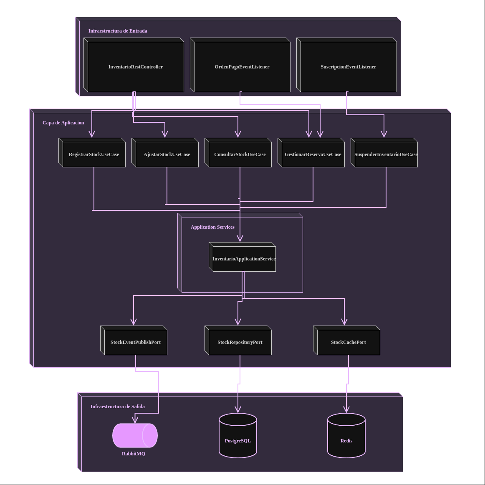
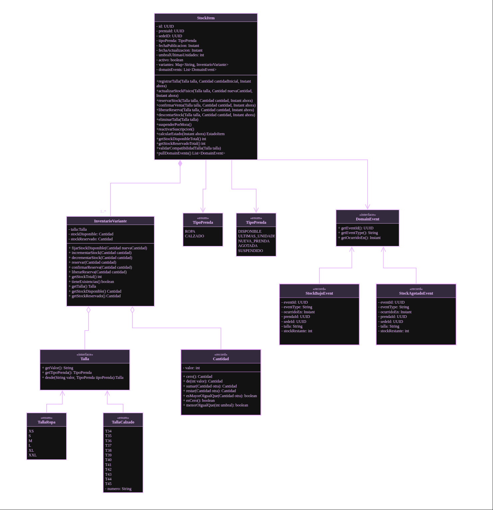
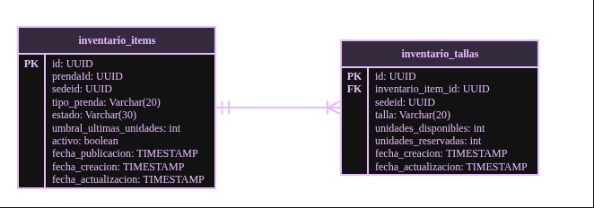

<div align="center">

  <a href="https://github.com/StyleRadar1">
    
  </a>

  <h1>STYLE<font color="#5600EF">RADAR</font> &nbsp;·&nbsp; <code>ms-inventario</code></h1>

  <p align="center">
    
    
    
  </p>

  <p align="center">
    <strong><font color="#5600EF">Descubre tu estilo. En tu ciudad.</font></strong><br />
    <em>Gestión transaccional de existencias multisede, validación de tallas y umbrales de agotado en tiempo real.</em>
  </p>

  <p align="center">
    <a href="https://styleradar-backend-prod.azurewebsites.net/swagger-ui/index.html">
      
    </a>
    <a href="https://styleradar-backend-qa.azurewebsites.net/swagger-ui/index.html">
      
    </a>
    <a href="target/site/jacoco/index.html">
      
    </a>
    <a href="#6-tecnologías-y-dependencias">
      
    </a>
    <a href="#6-tecnologías-y-dependencias">
      
    </a>
    <a href="#7-cómo-ejecutar-local-y-con-docker">
      
    </a>
  </p>

</div>

---

##  ÍNDICE DE CONTENIDOS

1. [Nombre del servicio y su bounded context](#1-nombre-del-servicio-y-su-bounded-context)
2. [Equipo y responsables](#2-equipo-y-responsables)
3. [Arquitectura hexagonal y evidencias de diseño](#3-arquitectura-hexagonal-y-evidencias-de-diseño)
4. [Endpoints y enlace a Swagger](#4-endpoints-y-enlace-a-swagger)
5. [Eventos que publica y consume](#5-eventos-que-publica-y-consume)
6. [Tecnologías y dependencias](#6-tecnologías-y-dependencias)
7. [Cómo ejecutar local y con Docker](#7-cómo-ejecutar-local-y-con-docker)
8. [Variables de entorno](#8-variables-de-entorno)
9. [Pruebas y cobertura](#9-pruebas-y-cobertura)
10. [CI/CD con el badge del pipeline](#10-cicd-con-el-badge-del-pipeline)
11. [Ramas y cómo contribuir](#11-ramas-y-cómo-contribuir)
12. [Enlace a la épica en Jira](#12-enlace-a-la-épica-en-jira)

---

<a id="1-nombre-del-servicio-y-su-bounded-context"></a>

##  1. NOMBRE DEL SERVICIO Y SU BOUNDED CONTEXT

* **Identificador de Servicio:** `ms-inventario`
* **Repositorio Oficial:** `RST-Inventario-Service`
* **Paquete Arquitectónico:** `Paquete 2: Catálogo`
* **Puerto de Escucha Oficial:** `8200`
* **Base de Datos Asignada:** `PostgreSQL 16` (`inventario_db`), aislada bajo el patrón *Database-per-Service*.
* **Bounded Context:** `Inventario y Gestión de Stock`

### Responsabilidades del Dominio

Este microservicio encapsula exclusivamente la lógica de negocio correspondiente al control de existencias físicas, variaciones de talla y estados de disponibilidad.

| Qué HACE este Microservicio (Alcance) | Qué NO HACE este Microservicio (Límites) |
| :--- | :--- |
| • Registra y actualiza el stock disponible por talla y sede física (SR-RF-50). | • NO gestiona geolocalización de tiendas (delegado a `ms-geolocalizacion` en `:8240`). |
| • Retorna existencias desglosadas por variantes sin inconsistencias (SR-RF-51). | • NO gestiona datos maestros de prendas (nombres, fotos, precios) (delegado a `ms-item-catalogo`). |
| • Aplica validaciones estrictas de tallas separando ropa de calzado (SR-RF-52). | • NO procesa pagos ni cobros de suscripciones (delegado a `ms-pagos-suscripciones` en `:8400`). |
| • Descuenta y reserva stock con bloqueo atómico para evitar sobreventas (SR-RF-53). | • NO gestiona perfiles ni autenticación de usuarios (delegado a `ms-usuarios` en `:8120`). |
| • Calcula etiquetas automáticas de "Últimas unidades" con umbral configurable (SR-RF-59). | • NO envía correos ni mensajes push directos (delegado a `ms-notificaciones` en `:8300`). |
| • Determina la vigencia de la etiqueta "Nueva prenda" durante 7 días (SR-RF-60). | • NO publica prendas directamente sin validar la existencia en el catálogo central. |

### Arquetipos de Moda y Personajes de StyleRadar

<div align="center">

| Antonia (Sastre) | Mateo (Calle) | Aura (Futuro) | Nora (Rebelde) | Tomás (Esencial) |
| :---: | :---: | :---: | :---: | :---: |
| <br>**Sastre**<br><sub>Tiendas & Descubrimiento</sub> | <br>**Calle**<br><sub>Playlists & Cultura Urbana</sub> | <br>**Futuro**<br><sub>Probador Virtual AI</sub> | <br>**Rebelde**<br><sub>Segunda Vida & Vintage</sub> | <br>**Esencial**<br><sub>Fundaciones & Donaciones</sub> |

</div>

---

<a id="2-equipo-y-responsables"></a>

##  2. EQUIPO Y RESPONSABLES

Desarrollado y mantenido por el **Squad Estación RESTrepo** para la asignatura DOSW 2026.

<div align="center">

| Rol | Nombre Completo | Usuario GitHub |
| :---: | :---: | :---: |
| **Product Owner / Líder** | Nicolás Álvarez | `[@JUANNICOLASA](https://github.com/JUANNICOLASA)` |
| **Arquitecto** | Daniel Mosquera | `[@DanielMosquera](https://github.com)` |

</div>

---

<a id="3-arquitectura-hexagonal-y-evidencias-de-diseño"></a>

##  3. ARQUITECTURA HEXAGONAL Y EVIDENCIAS DE DISEÑO

El microservicio implementa **Arquitectura Hexagonal (Puertos y Adaptadores)** combinada con **Domain-Driven Design (DDD)**. El núcleo de negocio permanece 100% puro y aislado de frameworks, bases de datos o brokers de mensajería.

### Estructura Oficial de Paquetes en `src/main/java/`

```text
src/main/java/edu/dosw/styleradar/inventario/
├── domain/                                  <-- NÚCLEO DE DOMINIO (Java puro, cero dependencias)
│   ├── model/                               <-- Agregado StockItem y entidad InventarioVariante
│   ├── valueobject/                         <-- Talla (TallaRopa, TallaCalzado), Cantidad
│   ├── event/                               <-- Domain Events (StockAgotadoEvent, StockBajoEvent)
│   └── exception/                           <-- Excepciones de negocio (StockInsuficienteException)
├── application/                             <-- CAPA DE APLICACIÓN (Casos de Uso)
│   ├── port/
│   │   ├── in/                              <-- Input Ports (Casos de uso invocados por adaptadores)
│   │   └── out/                             <-- Output Ports (Puertos SPI para DB, RabbitMQ y Redis)
│   ├── service/                             <-- Implementación de orquestación de aplicación
│   └── dto/                                 <-- DTOs inmutables de entrada y salida (Java Records)
└── infrastructure/                          <-- CAPA DE INFRAESTRUCTURA (Adaptadores)
    ├── adapter/
    │   ├── in/
    │   │   ├── rest/                        <-- Controladores REST y OpenAPI Controller
    │   │   └── amqp/                        <-- RabbitMQ Listeners (Eventos de pagos y suscripción)
    │   └── out/
    │       ├── persistence/                 <-- Repositorios Spring Data JPA y Entidades Relacionales
    │       ├── messaging/                   <-- Publicador RabbitMQ (AmqpTemplate)
    │       └── cache/                       <-- Adaptador Redis para lecturas de alto tráfico
    └── config/                              <-- Beans de configuración Spring (Security, AMQP, OpenAPI)
```

---

### Evidencias de Arquitectura (Jira RES-58)

1. Diagrama de Componentes (Arquitectura Hexagonal)
   
2. Diagrama de Clases (Dominio DDD Puro)
   
3. Modelo Entidad-Relación (Base de Datos PostgreSQL)
   

---

<a id="4-endpoints-y-enlace-a-swagger"></a>

##  4. ENDPOINTS Y ENLACE A SWAGGER

La documentación interactiva OpenAPI 3.0 y los contratos de ejecución se encuentran clasificados por entorno:

### Matriz Oficial de Enlaces por Entorno (PROD, QA, LOCAL)

| Entorno | Estado | Propósito | URL Base del Servicio | Swagger OpenAPI UI | Health Check |
| :--- | :---: | :--- | :--- | :--- | :--- |
| **Producción (PROD)** | Active | Despliegue productivo de StyleRadar | `https://styleradar-backend-prod.azurewebsites.net` | [Swagger UI PROD](https://styleradar-backend-prod.azurewebsites.net/swagger-ui/index.html) | [`/actuator/health`](https://styleradar-backend-prod.azurewebsites.net/actuator/health) |
| **Calidad / Pruebas (QA)** | Active | Pruebas integradas de Sprint y QA | `https://styleradar-backend-qa.azurewebsites.net` | [Swagger UI QA](https://styleradar-backend-qa.azurewebsites.net/swagger-ui/index.html) | [`/actuator/health`](https://styleradar-backend-qa.azurewebsites.net/actuator/health) |
| **Desarrollo Local (DEV)** | Local | Entorno de desarrollo local en máquina | `http://localhost:8200` | [Swagger UI Local](http://localhost:8200/swagger-ui.html) | [`/actuator/health`](http://localhost:8200/actuator/health) |

* **Especificación OpenAPI (Contrato JSON Schema):** `http://localhost:8200/v3/api-docs`

### Tabla de Endpoints Expuestos

| Método | Endpoint | Descripción | Rol Requerido | Códigos HTTP |
| :---: | :--- | :--- | :--- | :---: |
| `GET` | `/api/v1/inventario/health` | Health Check y estado de componentes (DB, Rabbit, Redis) | Público | `200`, `503` |
| `GET` | `/api/v1/inventario/prenda/{prendaId}` | Consulta stock y tallas disponibles por prenda | Autenticado | `200`, `404` |
| `POST` | `/api/v1/inventario` | Registro de existencias iniciales por sede y talla (SR-RF-50) | `TIENDA`, `ADMIN` | `201`, `400`, `409` |
| `PUT` | `/api/v1/inventario/{id}/ajuste` | Ajuste manual de existencias físicas por variante | `TIENDA`, `ADMIN` | `200`, `400`, `404` |
| `POST` | `/api/v1/inventario/reserva` | Bloqueo temporal atómico de unidades para compra (SR-RF-53) | Interno / Gateway | `200`, `400`, `409` |
| `POST` | `/api/v1/inventario/reserva/confirmar` | Confirmación definitiva de salida de stock por compra | Interno (`SISTEMA`) | `200`, `400`, `404` |
| `POST` | `/api/v1/inventario/reserva/liberar` | Liberación de stock reservado por cancelación o timeout | Interno (`SISTEMA`) | `200`, `400`, `404` |

<details>
<summary><b>Click para ver Ejemplos Interactivos de Request y Response JSON (Payloads)</b></summary>

<br>

#### Ejemplo Request (`POST /api/v1/inventario`)

```bash
curl -X POST "http://localhost:8200/api/v1/inventario" \
  -H "Content-Type: application/json" \
  -H "Authorization: Bearer <JWT_TOKEN>" \
  -d '{
    "prendaId": "018e3a2b-1111-7000-8000-000000000001",
    "sedeId": "018e3a2b-2222-7000-8000-000000000002",
    "tipoPrenda": "ROPA",
    "talla": "M",
    "cantidad": 10,
    "fechaPublicacion": "2026-11-01T10:00:00Z"
  }'
```

#### Ejemplo Response Exitoso (`201 Created`)

```json
{
  "id": "018e3a2b-3333-7000-8000-000000000003",
  "prendaId": "018e3a2b-1111-7000-8000-000000000001",
  "sedeId": "018e3a2b-2222-7000-8000-000000000002",
  "tipoPrenda": "ROPA",
  "talla": "M",
  "stockDisponible": 10,
  "stockReservado": 0,
  "estado": "NUEVA_PRENDA",
  "activo": true,
  "fechaActualizacion": "2026-11-04T15:00:00Z"
}
```

</details>

---

<a id="5-eventos-que-publica-y-consume"></a>

##  5. EVENTOS QUE PUBLICA Y CONSUME

La comunicación asíncrona entre microservicios se orquesta a través de **RabbitMQ 3.12** utilizando Topic Exchanges durables.

* **Exchange Principal de Dominio:** `styleradar.events` (`topic`, durable)
* **Dead Letter Exchange (DLX):** `styleradar.dlx`

### Matriz de Eventos AMQP

| Tipo | Routing Key | Cola (Queue) | Microservicio Emisor / Receptor | Cuándo se Dispara / Acción |
| :---: | :--- | :--- | :--- | :--- |
| **PUBLICA** | `inventario.stock.ultimas-unidades` | N/A (Exchange) | `ms-inventario` | Se dispara al cruzar el umbral mínimo (default 3 unidades). |
| **PUBLICA** | `inventario.stock.agotado` | N/A (Exchange) | `ms-inventario` | Notifica a `ms-notificaciones` para alertar usuarios con wishlist. |
| **CONSUME** | `tienda.suscripcion.suspendida` | `q.inventario.suscripcion` | `ms-pagos-suscripciones` &rarr; `ms-inventario` | Inhabilita la visibilidad del stock de la tienda por mora de pago. |
| **CONSUME** | `orden.pago.aprobado` | `q.inventario.pago-aprobado` | `ms-pagos-suscripciones` &rarr; `ms-inventario` | Consolida la salida definitiva del stock reservado. |
| **CONSUME** | `orden.pago.rechazado` | `q.inventario.pago-rechazado` | `ms-pagos-suscripciones` &rarr; `ms-inventario` | Libera la reserva y regresa el stock a estado disponible. |

<details>
<summary><b>Click para ver Esquema JSON del Evento Publicado (con Idempotencia)</b></summary>

<br>

```json
{
  "eventId": "018e3a2b-4444-7000-8000-000000000004",
  "eventType": "inventario.stock.ultimas-unidades",
  "timestamp": "2026-11-04T15:00:00Z",
  "producer": "ms-inventario",
  "correlationId": "corr-uuid-1010",
  "data": {
    "prendaId": "018e3a2b-1111-7000-8000-000000000001",
    "sedeId": "018e3a2b-2222-7000-8000-000000000002",
    "talla": "M",
    "stockRestante": 2,
    "estado": "ULTIMAS_UNIDADES"
  }
}
```

</details>

---

<a id="6-tecnologías-y-dependencias"></a>

##  6. TECNOLOGÍAS Y DEPENDENCIAS

El stack del microservicio cumple con el estándar unificado de arquitectura de StyleRadar:

| Capa / Componente | Tecnología | Versión | Justificación Técnica |
| :--- | :--- | :--- | :--- |
| **Lenguaje Core** | Java LTS | `21` | Records, tipos sellados y Virtual Threads para concurrencia masiva sin saturar el SO. |
| **Framework Empresarial** | Spring Boot | `3.3.x` | Ecosistema nativo Spring Data JPA, Spring AMQP y validaciones declarativas. |
| **Base de Datos** | PostgreSQL | `16` | Integridad transaccional ACID, bloqueos `FOR UPDATE` y aislamiento por esquema. |
| **Migraciones de BD** | Flyway | `10.x` | Versionado de scripts DDL (`V1__init_inventario.sql`) ejecutados al arranque del contenedor. |
| **Broker de Mensajería** | RabbitMQ | `3.12+` | Desacoplamiento asíncrono con Topic Exchanges durables y Dead Letter Queues. |
| **Caché en Memoria** | Redis | `7.x` | Caché L2 para absorber ráfagas de lectura de disponibilidad inmediata en el radar. |
| **Mapeo de DTOs** | MapStruct | `1.5.x` | Transformación de DTOs y entidades en tiempo de compilación con cero reflexión. |
| **Testing Core** | JUnit 5 + Mockito | `5.10.x` | Pruebas unitarias de dominio puro aisladas del framework Spring. |
| **Testing Integración** | Testcontainers | `1.19.x` | Contenedores efímeros Docker de PostgreSQL y RabbitMQ en fase `verify`. |
| **Métricas de Cobertura** | JaCoCo Plugin | `0.8.12` | Verificación automática de umbral mínimo de cobertura (≥ 85%). |

---

<a id="7-cómo-ejecutar-local-y-con-docker"></a>

##  7. CÓMO EJECUTAR LOCAL Y CON DOCKER

### Prerrequisitos de Entorno

* **Java Development Kit (JDK):** Versión 21 LTS instalada (`java -version`).
* **Apache Maven:** Versión 3.9+ instalada (`mvn -version`).
* **Docker Engine & Docker Compose:** Versión 24+ en ejecución (`docker --version`).

### Archivo de Configuración Local (`.env.example`)

Copia la plantilla a la raíz del proyecto antes de levantar los contenedores:

```bash
cp .env.example .env
```

```dotenv
# ==============================================================================
# CONFIGURACIÓN DE ENTORNO - MS-INVENTARIO
# ==============================================================================

# Configuración del Servidor
SERVER_PORT=8200
SPRING_PROFILES_ACTIVE=dev

# PostgreSQL (Local: localhost / Producción: styleradar-postgres-prod.postgres.database.azure.com)
DB_HOST=localhost
DB_PORT=5432
DB_NAME=inventario_db
DB_USER=styleradar_user
DB_PASSWORD=secret_dev_pass

# RabbitMQ Broker
RABBITMQ_HOST=localhost
RABBITMQ_PORT=5672
RABBITMQ_USER=guest
RABBITMQ_PASSWORD=guest

# Redis Cache L2
REDIS_HOST=localhost
REDIS_PORT=6379

# Parámetros de Dominio
UMBRAL_ULTIMAS_UNIDADES=3
```

### Orquestación de Infraestructura Local (`docker-compose.yml`)

```yaml
version: '3.8'

services:
  postgres:
    image: postgres:16-alpine
    container_name: styleradar-postgres-inventario
    environment:
      POSTGRES_DB: inventario_db
      POSTGRES_USER: styleradar_user
      POSTGRES_PASSWORD: secret_dev_pass
    ports:
      - "5432:5432"
    volumes:
      - postgres_inventario_data:/var/lib/postgresql/data
    healthcheck:
      test: ["CMD-SHELL", "pg_isready -U styleradar_user -d inventario_db"]
      interval: 5s
      timeout: 5s
      retries: 5

  rabbitmq:
    image: rabbitmq:3.12-management-alpine
    container_name: styleradar-rabbitmq-inventario
    environment:
      RABBITMQ_DEFAULT_USER: guest
      RABBITMQ_DEFAULT_PASS: guest
    ports:
      - "5672:5672"
      - "15672:15672"
    healthcheck:
      test: ["CMD", "rabbitmq-diagnostics", "-q", "ping"]
      interval: 10s
      timeout: 5s
      retries: 5

  redis:
    image: redis:7-alpine
    container_name: styleradar-redis-inventario
    ports:
      - "6379:6379"
    healthcheck:
      test: ["CMD", "redis-cli", "ping"]
      interval: 5s
      timeout: 3s
      retries: 5

volumes:
  postgres_inventario_data:
```

### Ejecución Paso a Paso

```bash
# 1. Clonar el repositorio
git clone https://github.com/StyleRadar1/ms-inventario.git
cd ms-inventario

# 2. Levantar la infraestructura en segundo plano
docker compose up -d

# 3. Compilar y ejecutar la aplicación con el perfil 'dev'
mvn clean spring-boot:run -Dspring-boot.run.profiles=dev
```

### Comprobación de Salud (Health Check)

```bash
curl -s http://localhost:8200/actuator/health | jq .
# Esperado: {"status":"UP","components":{"db":{"status":"UP"},"rabbit":{"status":"UP"}}}
```

---

<a id="8-variables-de-entorno"></a>

##  8. VARIABLES DE ENTORNO

Todas las configuraciones se externalizan mediante variables conformes al estándar **Twelve-Factor App**.

| Variable | Descripción | Valor por Defecto (`dev`) | Valor Oficial Producción (`prod`) |
| :--- | :--- | :--- | :--- |
| `SERVER_PORT` | Puerto de escucha HTTP del servicio | `8200` | `8200` |
| `SPRING_PROFILES_ACTIVE` | Perfil de configuración Spring | `dev` | `prod` |
| `DB_HOST` | Host del servidor PostgreSQL | `localhost` | `styleradar-postgres-prod.postgres.database.azure.com` |
| `DB_PORT` | Puerto de PostgreSQL | `5432` | `5432` |
| `DB_NAME` | Base de datos asignada al bounded context | `inventario_db` | `inventario_db` |
| `DB_USER` | Usuario de conexión a la BD | `styleradar_user` | `styleradar_admin` (Azure Secret) |
| `DB_PASSWORD` | Contraseña de base de datos | `secret_dev_pass` | `KeyVault-Secret` |
| `RABBITMQ_HOST` | Hostname del broker AMQP | `localhost` | `styleradar-rabbit-prod.azurewebsites.net` |
| `RABBITMQ_PORT` | Puerto de conexión AMQP | `5672` | `5672` |
| `REDIS_HOST` | Servidor Redis para caché L2 | `localhost` | `styleradar-redis-prod.redis.cache.windows.net` |
| `REDIS_PORT` | Puerto de Redis | `6379` | `6380` (SSL) |
| `UMBRAL_ULTIMAS_UNIDADES` | Stock límite para etiqueta automática | `3` | `3` |

---

<a id="9-pruebas-y-cobertura"></a>

##  9. PRUEBAS Y COBERTURA (≥ 85%)

El proyecto exige una cobertura de código mínima del **85%** verificada automáticamente mediante el plugin de **JaCoCo** durante la fase de compilación.

```bash
# Ejecutar suite de pruebas unitarias y de integración
mvn clean verify

# Generar reporte HTML consolidado de JaCoCo
mvn jacoco:report
```

* **Ruta del Reporte HTML:** `target/site/jacoco/index.html`

> [!IMPORTANT]
> **Regla Estricta en CI:** El archivo `pom.xml` contiene el límite `<minimum>0.85</minimum>`. Si la cobertura total es inferior al 85%, el comando `mvn verify` fallará bloqueando la integración en GitHub Actions.

---

<a id="10-cicd-con-el-badge-del-pipeline"></a>

##  10. CI/CD CON EL BADGE DEL PIPELINE

* **Pipeline QA:** [](https://github.com/StyleRadar1/ms-inventario/actions)
* **Pipeline PROD:** [](https://github.com/StyleRadar1/ms-inventario/actions)

---

<a id="11-ramas-y-cómo-contribuir"></a>

##  11. RAMAS Y CÓMO CONTRIBUIR

El equipo sigue el modelo **GitFlow adaptado para microservicios**.

### Formato de Ramas Oficial

```text
main                    <-- Producción
└── develop             <-- Integración continua (Staging / QA)
    ├── feature/RES-<ID>-<descripcion-corta>   <-- Nuevas funcionalidades
    └── bugfix/RES-<ID>-<descripcion-corta>    <-- Corrección de defectos
```

### Convención de Commits (*Conventional Commits*)

```text
feat(inventario): validar tipos de talla ropa y calzado [#SR-RF-52]
feat(inventario): configurar etiqueta ultimas unidades umbral 3 [#SR-RF-59]
fix(inventario): corregir calculo de vigencia de 7 dias en nueva llegada [#SR-RF-60]
test(inventario): agregar pruebas unitarias para agregado StockItem [#SR-RF-50]
```

---

<a id="12-enlace-a-la-épica-en-jira"></a>

##  12. ENLACE A LA ÉPICA EN JIRA

* **Épica Oficial:** [Épica RES-1 · Paquete 2: Catálogo en Jira](https://mail-team-nyjtgqcj.atlassian.net/jira/software/projects/RES/boards/76/timeline?selectedIssue=RES-1)
* **Tablero Scrum:** [Tablero Squad Estación RESTrepo](https://mail-team-nyjtgqcj.atlassian.net/jira/software/projects/RES/boards/76)

### Tareas Asignadas del Microservicio en Jira

| Identificador | Tarea / Título | Responsable | Estado |
| :---: | :--- | :---: | :---: |
| `RES-58` | ms-inventario \| Diagramas del servicio (Componentes, Clases, DER) | Daniel Mosquera | `COMPLETADA` |
| `RES-59` | ms-inventario \| Documento técnico y revista del microservicio | Daniel Mosquera | `COMPLETADA` |

### Requerimientos Funcionales Asignados

| Código RF | Nombre del Requerimiento | Actor Principal | Criterio de Aceptación Clave |
| :---: | :--- | :--- | :--- |
| `SR-RF-50` | Registrar stock inicial de prendas | Tienda / Admin | Permite asociar existencias por sede física con persistencia transaccional. |
| `SR-RF-51` | Consultar disponibilidad por talla | Comprador / Tienda | Retorna existencias desglosadas por variante sin inconsistencias. |
| `SR-RF-52` | Ajustar validación de tallas (ropa vs. calzado) | Tienda | Impide registrar tallas numéricas de calzado en prendas de vestir y viceversa. |
| `SR-RF-53` | Descontar stock por compra o reserva | Sistema | Ejecuta decremento atómico previniendo sobreventas o existencias negativas. |
| `SR-RF-59` | Etiqueta automática "Últimas unidades" | Sistema | Aplica etiqueta automáticamente cuando el stock cae a 3 o menos unidades. |
| `SR-RF-60` | Etiqueta automática "Nueva llegada" | Sistema | Mantiene vigente la marca de novedad durante exactamente 7 días tras el alta. |
```