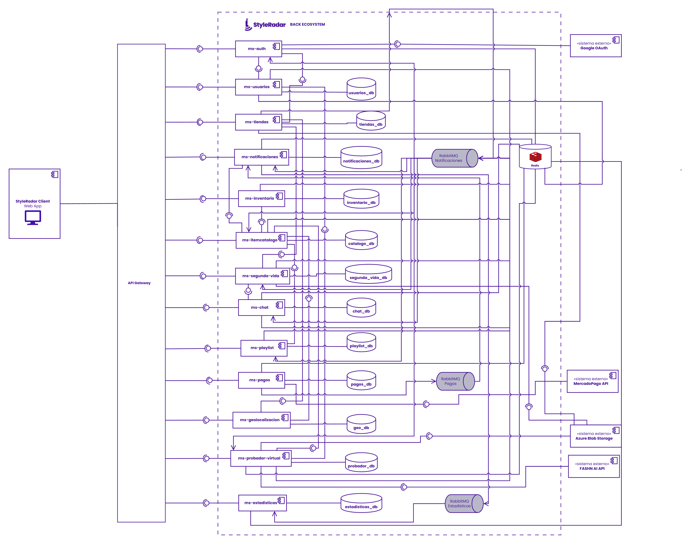
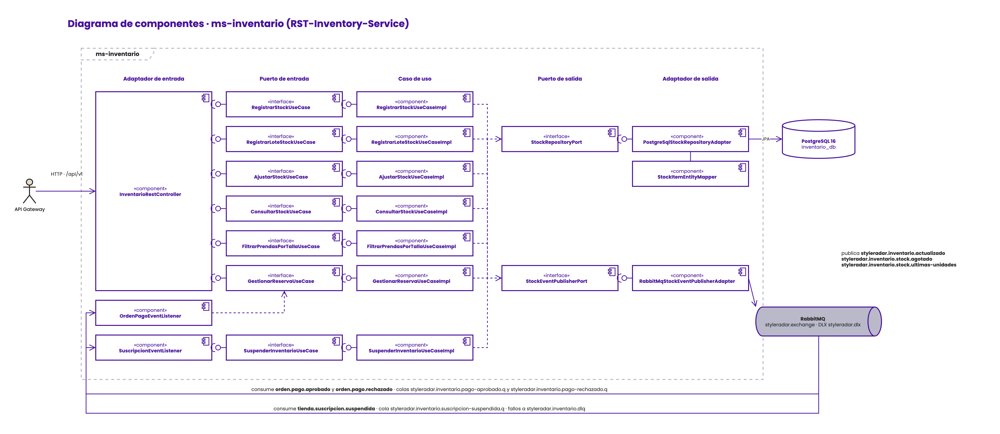
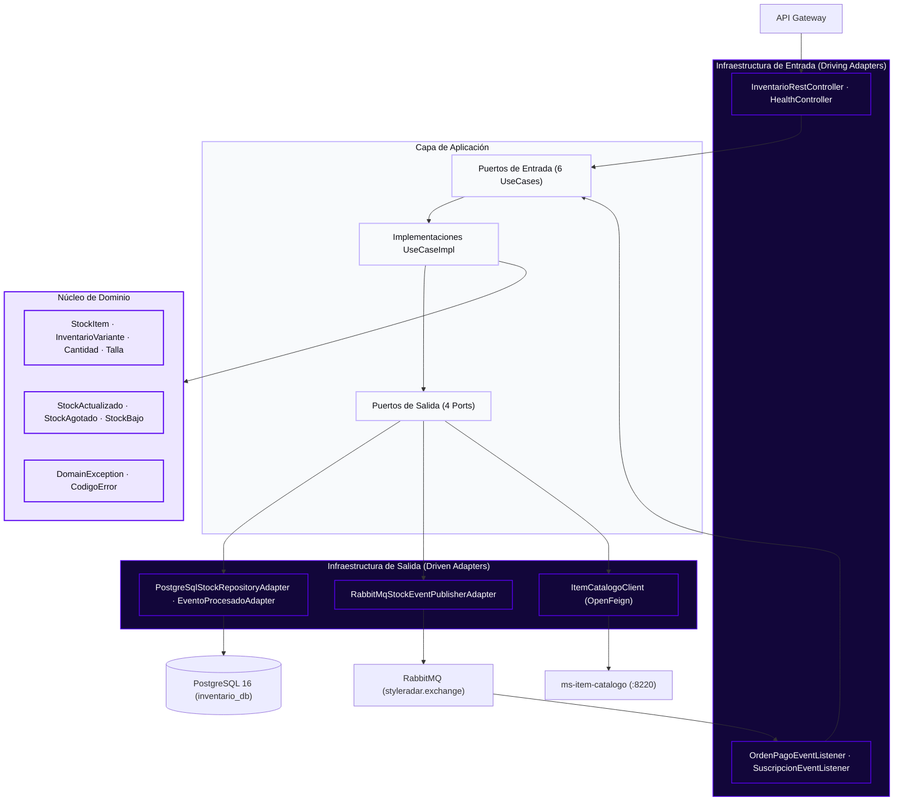
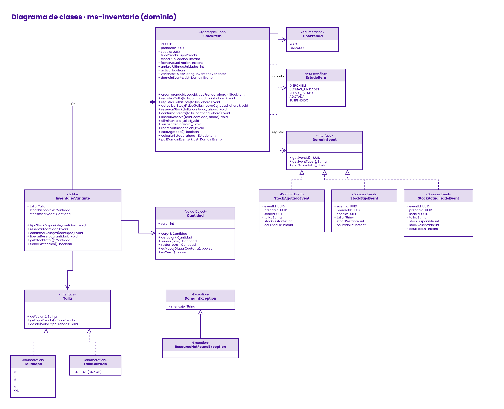
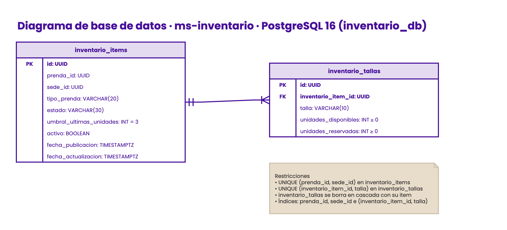
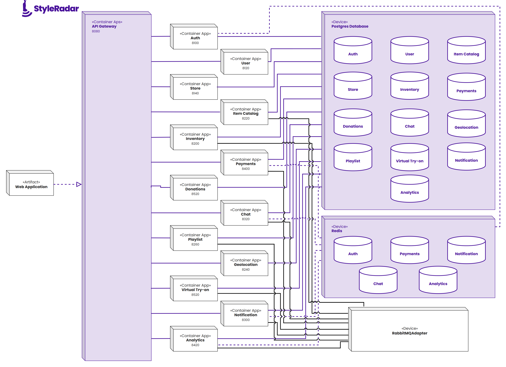
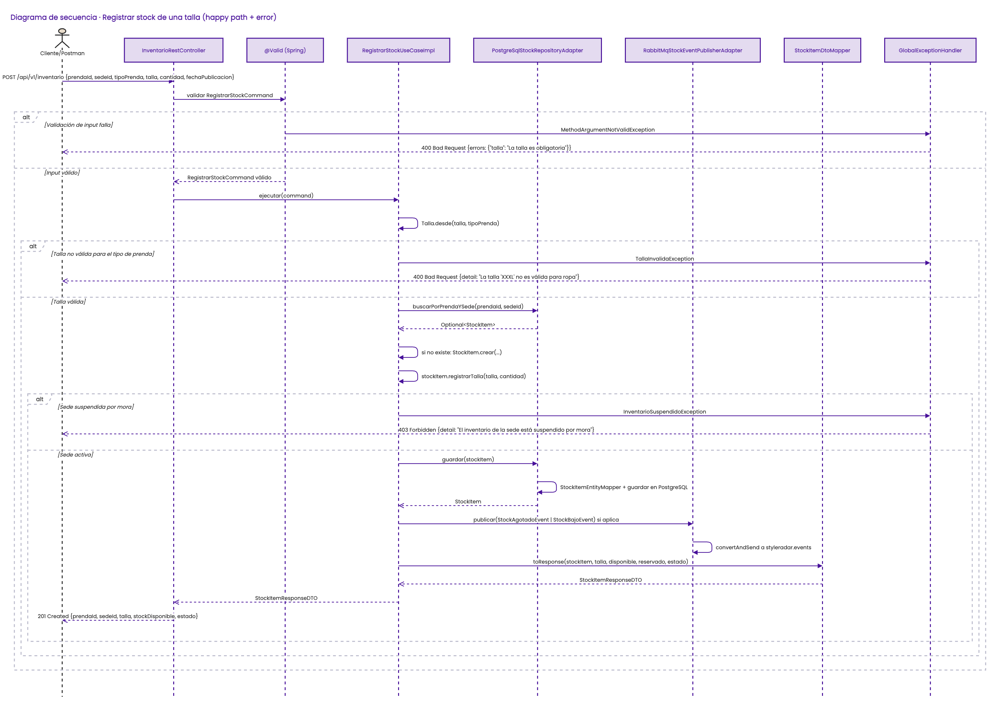
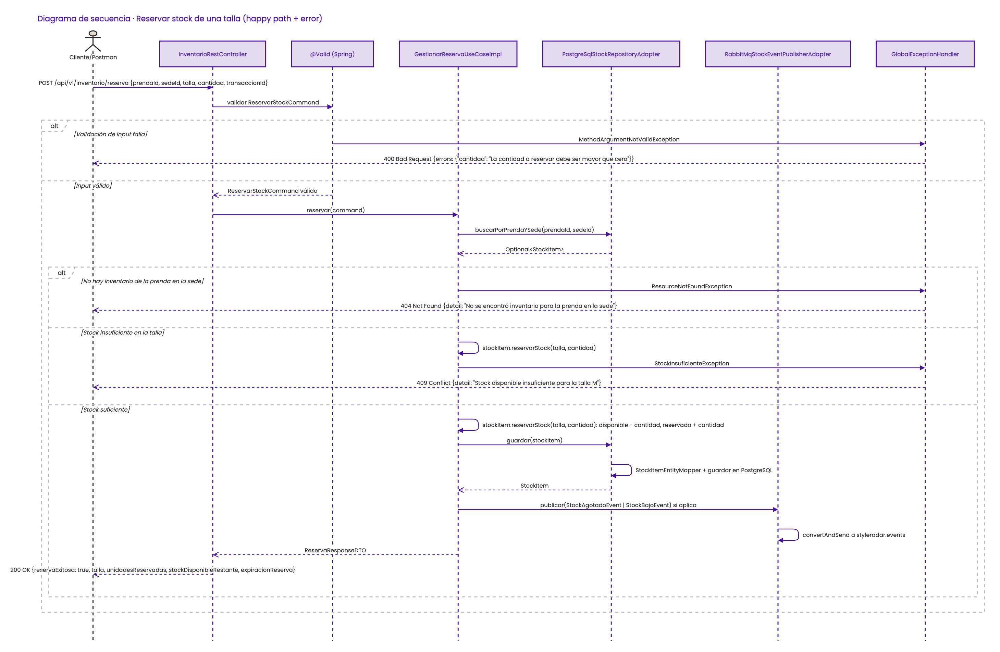

[⬅ Volver al README Principal](../../README.md)

---

## 2. ARQUITECTURA HEXAGONAL CON SUS DIAGRAMAS

El servicio implementa **Arquitectura Hexagonal (Puertos y Adaptadores)** con diseño guiado por el dominio (**DDD**). El núcleo (`domain/`) es Java puro sin dependencias de Spring, JPA, RabbitMQ ni OpenFeign; todas las interacciones externas ocurren mediante puertos de entrada (`domain/port/in`) y puertos de salida (`domain/port/out`) implementados por adaptadores intercambiables en `infrastructure/adapter/`.

### Diagramas del Microservicio

#### 2.1 Diagrama de Componentes General

<div align="center">
  
</div>
<p align="center"><sub><i>Nota: Archivo editable en <code>docs/evidencias/DespligueYComponentesGeneral.drawio</code>. Si los PNG residen aún en <code>docs/evidencias/</code>, copiarlos a <code>docs/uml/</code>.</i></sub></p>

##### Justificación y Explicación Técnica del Diagrama de Componentes General

La vista general representa la arquitectura distribuida de StyleRadar bajo el patrón *API Gateway* y *Database-per-Service*. Las peticiones de clientes ingresan por el Gateway hacia `ms-inventario` (`:8200`), el cual mantiene aislada su propia base de datos PostgreSQL (`inventario_db`), se comunica de manera síncrona saliente con `ms-item-catalogo` (`:8220`) vía OpenFeign para validar prendas al registrar lotes, e intercambia eventos de dominio de forma asíncrona con `ms-item-catalogo`, `ms-pagos`, `ms-notifications` y `ms-estadisticas` a través del broker RabbitMQ (`styleradar.exchange`).

#### 2.2 Diagrama de Componentes Específico

<div align="center">
  
</div>
<p align="center"><sub><i>Nota: Archivo editable en <code>docs/evidencias/DiagramaComponentesInventario.drawio</code>.</i></sub></p>

##### Justificación y Explicación Técnica del Diagrama de Componentes Específico

* **Adaptadores de Entrada (`infrastructure/adapter/in/`):** `InventarioRestController` y `HealthController` exponen la API REST bajo `/api/v1/inventory` y `/api/v1/health`, mientras que `OrdenPagoEventListener` y `SuscripcionEventListener` consumen mensajes JSON desde RabbitMQ asegurando idempotencia. Todos invocan exclusivamente interfaces en `domain/port/in/`.
* **Capa de Aplicación (`application/`):** Los seis servicios `*UseCaseImpl` orquestan transacciones (`@Transactional`), obtienen agregados vía puertos, coordinan `StockItemDtoMapper` (MapStruct) y despachan los eventos de dominio acumulados en `StockItem.pullDomainEvents()`.
* **Adaptadores de Salida (`infrastructure/adapter/out/`):** `PostgreSqlStockRepositoryAdapter` y `PostgreSqlEventoProcesadoAdapter` persisten en PostgreSQL mediante Spring Data JPA y `StockItemEntityMapper`; `RabbitMqStockEventPublisherAdapter` publica eventos hacia `styleradar.exchange` capturando `AmqpException` para no degradar operaciones si el broker cae temporalmente; y `ItemCatalogoClient` encapsula `ItemCatalogoFeignClient` (`GET /api/v1/garments/{id}`).



#### 2.3 Diagrama de Clases del Modelo de Dominio

<div align="center">
  
</div>
<p align="center"><sub><i>Nota: Archivo editable en <code>docs/evidencias/DiagramaClasesInventario.drawio</code>.</i></sub></p>

##### Justificación y Explicación Técnica del Diagrama de Clases del Dominio

* **Agregado Raíz `StockItem`:** Modela el inventario de una pareja única `(prendaId, sedeId)` con su `TipoPrenda` (`ROPA` o `CALZADO`), `fechaPublicacion`, `umbralUltimasUnidades` (`3` por defecto), bandera `activo` y mapa de variantes por talla (`InventarioVariante`).
* **Value Objects e Invariantes:** `Cantidad` (Java `record`) impide valores negativos; `Talla` es una `sealed interface` de Java 21 implementada únicamente por `TallaRopa` (`XS`–`XXL`) y `TallaCalzado` (`34`–`45`), garantizando compatibilidad estricta en tiempo de ejecución (`TallaInvalidaException`).
* **Comportamiento y Eventos:** `StockItem` encapsula `registrarTalla`, `registrarTallasLote`, `actualizarStockFisico`, `reservarStock`, `confirmarVenta`, `liberarReserva`, `descontarStock`, `eliminarTalla` (prohibida si tiene unidades), `suspenderPorMora`, `reactivarSuscripcion` y `calcularEstado` (`SUSPENDIDO`, `AGOTADA`, `ULTIMAS_UNIDADES`, `NUEVA_PRENDA`, `DISPONIBLE`). Cada mutación de unidades registra eventos de dominio (`StockActualizadoEvent`, `StockAgotadoEvent`, `StockBajoEvent`). Las excepciones heredan de `DomainException` y portan un `CodigoError` estandarizado.

#### 2.4 Diagrama de Base de Datos

<div align="center">
  
</div>
<p align="center"><sub><i>Nota: Archivo editable en <code>docs/evidencias/DiagramaEntidadRelacionInventario.drawio</code>.</i></sub></p>

##### Justificación y Explicación Técnica del Modelo Relacional

El esquema en **PostgreSQL 16** (`inventario_db`, validado con `ddl-auto: validate` y versionado por **Flyway** en `classpath:db/migration`) se compone de tres tablas reales:
* **`inventario_items` (`StockItemJpaEntity`):** Almacena `id` (PK UUID), `prenda_id`, `sede_id`, `tipo_prenda`, `estado`, `umbral_ultimas_unidades`, `activo`, `fecha_publicacion` y `fecha_actualizacion`, con restricción única `uk_inventario_prenda_sede` sobre `(prenda_id, sede_id)`.
* **`inventario_tallas` (`InventarioVarianteJpaEntity`):** Relación `1:N` hacia `inventario_items` (`inventario_item_id` FK), guarda `id` (UUID determinístico generado por `stockItemId:talla`), `talla` (hasta 10 caracteres), `unidades_disponibles` y `unidades_reservadas`, con restricción única `uk_inventario_item_talla` sobre `(inventario_item_id, talla)`.
* **`eventos_procesados` (`EventoProcesadoJpaEntity`):** Tabla de idempotencia AMQP con llave primaria `event_id`, `event_type` y `procesado_en` para garantizar procesamiento *at-most-once* de eventos de pago y suscripción.
* **Bloqueo transaccional y privacidad:** Las operaciones de reserva usan `LockModeType.PESSIMISTIC_WRITE` (`buscarPorPrendaYSedeConBloqueo`) para prevenir condiciones de carrera sobre stock concurrente. Bajo *Database-per-Service*, no se almacenan datos personales de compradores.

#### 2.5 Diagrama de Despliegue General

<div align="center">
  
</div>
<p align="center"><sub><i>Nota: Archivo editable en <code>docs/evidencias/DespligueYComponentesGeneral.drawio</code>.</i></sub></p>

##### Justificación y Explicación Técnica de la Topología de Despliegue

El servicio corre en un contenedor OCI Java 21 exponiendo el puerto **`8200`** detrás de **Azure Container Apps** (entornos **QA** desde `develop` y **PROD** desde `master`), con `server.forward-headers-strategy: framework` y `ForwardedHeaderFilter` habilitado para procesar cabeceras `X-Forwarded-*` del *Ingress*. En local se levanta mediante `docker-compose.yml` junto a `postgres:16-alpine` y `rabbitmq:3.13.7-management-alpine`. En nube se conecta al PostgreSQL compartido con pool HikariCP restringido (`maximum-pool-size: 3`, `minimum-idle: 1`), a RabbitMQ sobre TLS (`:5671`), y por HTTP hacia `ms-item-catalogo` (`ITEM_CATALOGO_URL`, timeouts `5s`/`15s`).

#### 2.6 Diagrama de Secuencia de Flujos Críticos

<div align="center">
  
</div>

<div align="center">
  
</div>

<p align="center"><sub><i>Nota: Archivos editables en <code>docs/evidencias/</code>. [PENDIENTE: agregar un tercer diagrama de secuencia específico para el flujo de consulta/disponibilidad o manejo de excepciones si se requiere en gráfico independiente.]</i></sub></p>

##### Justificación y Explicación Técnica de los Flujos Críticos

1. **Escenario 1 · Registrar stock por lote (`POST /api/v1/inventory/batch`, `SR-RF-52`):**
   Spring valida `RegistrarLoteStockCommand` (`400 DATOS_INVALIDOS` si faltan campos). `RegistrarLoteStockUseCaseImpl` invoca a `ItemCatalogoClient` (`GET /api/v1/garments/{id}`): si catálogo devuelve `404`, responde `404 PRENDA_NO_ENCONTRADA`; si catálogo no responde o falla, `503 CATALOGO_NO_DISPONIBLE`; si `almacenId` no coincide con `sedeId`, `403 PRENDA_DE_OTRO_ALMACEN`. Luego interpreta cada talla según `TipoPrenda`, crea o actualiza el agregado `StockItem`, persiste en PostgreSQL, publica `StockActualizadoEvent` (y `StockBajoEvent`/`StockAgotadoEvent` si aplica) en RabbitMQ y retorna `201 Created` con `DisponibilidadPrendaResponseDTO`.
2. **Escenario 2 · Reservar stock con bloqueo pesimista (`POST /api/v1/inventory/reservations`, `SR-RF-53`):**
   `GestionarReservaUseCaseImpl` consulta `buscarPorPrendaYSedeConBloqueo` (`PESSIMISTIC_WRITE`, lanzando `404 INVENTARIO_NO_ENCONTRADO` si no existe). Si la sede está suspendida lanza `403 INVENTARIO_SUSPENDIDO`; si no alcanzan las unidades disponibles en esa talla lanza `409 STOCK_INSUFICIENTE`. En caso válido, descuenta de `stockDisponible`, suma a `stockReservado`, persiste, publica eventos en RabbitMQ y responde `200 OK` con `expiracionReserva` (+15 minutos).
3. **Escenario 3 · Manejo centralizado de excepciones (RFC 7807):**
   `GlobalExceptionHandler` (`@RestControllerAdvice`) intercepta tanto excepciones de dominio (`DomainException`) como errores de deserialización, tipo de parámetro, rutas inexistentes (`NoResourceFoundException` $\rightarrow$ `404 RUTA_NO_ENCONTRADA`) y Bean Validation (`400 DATOS_INVALIDOS` con mapa `errors`), devolviendo siempre `ProblemDetail` (`application/problem+json`) con propiedades estándar `code` y `timestamp`.

### Estructura Oficial de Paquetes en `src/main/java/edu/dosw/styleradar/inventario/`

```text
src/main/java/edu/dosw/styleradar/inventario/
├── InventoryServiceApplication.java
├── domain/
│   ├── model/
│   │   ├── EstadoItem.java
│   │   ├── InventarioVariante.java
│   │   ├── StockItem.java
│   │   └── TipoPrenda.java
│   ├── valueobject/
│   │   ├── Cantidad.java
│   │   ├── Talla.java
│   │   ├── TallaCalzado.java
│   │   └── TallaRopa.java
│   ├── event/
│   │   ├── DomainEvent.java
│   │   ├── StockActualizadoEvent.java
│   │   ├── StockAgotadoEvent.java
│   │   └── StockBajoEvent.java
│   ├── exception/
│   │   ├── CantidadInvalidaException.java
│   │   ├── CatalogoNoDisponibleException.java
│   │   ├── CodigoError.java
│   │   ├── DomainException.java
│   │   ├── InventarioSuspendidoException.java
│   │   ├── PrendaDeOtroAlmacenException.java
│   │   ├── PrendaNoEncontradaEnCatalogoException.java
│   │   ├── ResourceNotFoundException.java
│   │   ├── StockInsuficienteException.java
│   │   ├── TallaConUnidadesException.java
│   │   ├── TallaInvalidaException.java
│   │   └── TallaNoRegistradaException.java
│   └── port/
│       ├── in/
│       │   ├── AjustarStockUseCase.java
│       │   ├── ConsultarStockUseCase.java
│       │   ├── FiltrarPrendasPorTallaUseCase.java
│       │   ├── GestionarReservaUseCase.java
│       │   ├── RegistrarLoteStockUseCase.java
│       │   ├── RegistrarStockUseCase.java
│       │   └── SuspenderInventarioUseCase.java
│       └── out/
│           ├── EventoProcesadoPort.java
│           ├── ItemCatalogoPort.java
│           ├── PrendaCatalogoInfo.java
│           ├── StockEventPublisherPort.java
│           └── StockRepositoryPort.java
├── application/
│   ├── usecase/
│   │   ├── AjustarStockUseCaseImpl.java
│   │   ├── ConsultarStockUseCaseImpl.java
│   │   ├── FiltrarPrendasPorTallaUseCaseImpl.java
│   │   ├── GestionarReservaUseCaseImpl.java
│   │   ├── RegistrarLoteStockUseCaseImpl.java
│   │   ├── RegistrarStockUseCaseImpl.java
│   │   └── SuspenderInventarioUseCaseImpl.java
│   ├── dto/
│   │   ├── ActualizarDisponibilidadDTO.java
│   │   ├── AjustarStockCommand.java
│   │   ├── ConfirmarReservaCommand.java
│   │   ├── DisponibilidadPrendaResponseDTO.java
│   │   ├── ItemTallaCantidadDTO.java
│   │   ├── LiberarReservaCommand.java
│   │   ├── RegistrarLoteStockCommand.java
│   │   ├── RegistrarStockCommand.java
│   │   ├── ReservaResponseDTO.java
│   │   ├── ReservarStockCommand.java
│   │   ├── SedeStockDTO.java
│   │   ├── StockItemResponseDTO.java
│   │   ├── VarianteStockDTO.java
│   │   └── VerificacionDisponibilidadDTO.java
│   └── mapper/
│       └── StockItemDtoMapper.java
└── infrastructure/
    ├── adapter/
    │   ├── in/
    │   │   ├── rest/
    │   │   │   ├── GlobalExceptionHandler.java
    │   │   │   ├── HealthController.java
    │   │   │   ├── InventarioRestController.java
    │   │   │   └── doc/
    │   │   │       └── HealthApi.java
    │   │   └── amqp/
    │   │       ├── OrdenPagoEventListener.java
    │   │       └── SuscripcionEventListener.java
    │   └── out/
    │       ├── persistence/
    │       │   ├── PostgreSqlEventoProcesadoAdapter.java
    │       │   ├── PostgreSqlStockRepositoryAdapter.java
    │       │   ├── entity/
    │       │   │   ├── EventoProcesadoJpaEntity.java
    │       │   │   ├── InventarioVarianteJpaEntity.java
    │       │   │   └── StockItemJpaEntity.java
    │       │   ├── mapper/
    │       │   │   └── StockItemEntityMapper.java
    │       │   └── repository/
    │       │       ├── SpringDataEventoProcesadoRepository.java
    │       │       └── SpringDataStockItemRepository.java
    │       ├── messaging/
    │       │   └── RabbitMqStockEventPublisherAdapter.java
    │       └── external/
    │           ├── ItemCatalogoClient.java
    │           ├── ItemCatalogoFeignClient.java
    │           └── PrendaCatalogoDto.java
    └── config/
        ├── BeanConfig.java
        ├── CorsConfig.java
        ├── FeignConfig.java
        ├── OpenApiConfig.java
        └── RabbitMqConfig.java
```

---

[⬅ Volver al README Principal](../../README.md)
