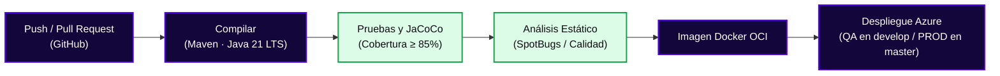

[⬅ Volver al README Principal](../../README.md)

---

## 9. CI/CD Y PIPELINE AUTOMATIZADO

Los flujos de Integración Continua y Despliegue Continuo (CI/CD) de `ms-playlist` operan sobre **GitHub Actions**, ejecutando compilación, pruebas automatizadas, verificación de cobertura JaCoCo, análisis estático con SpotBugs y construcción/despliegue de imagen Docker OCI hacia **Azure Container Apps** (`[PENDIENTE: confirmar nombres exactos de los archivos en .github/workflows/]`).

### Badges de Pipelines y Calidad (GitHub Actions & SonarCloud)

  

    
    
    
    
  

*(Nota: actualizar los enlaces de los badges con el archivo exacto del workflow en `.github/workflows/` y la clave de proyecto de SonarCloud una vez confirmados `[PENDIENTE: enlaces exactos de workflow y SonarCloud]`).*

### Matriz de Pipelines por Rama Protegida

| Pipeline | Rama / Entorno | Trigger de Ejecución | Quality Gate Requerido | Estado |
| :--- | :--- | :--- | :--- | :---: |
| **CI Pull Request (`[PENDIENTE: nombre workflow]`)** | `feature/*`, `fix/*`, `refactor/*`, `docs/*` &rarr; `develop` | `pull_request` hacia `develop` / `master` | Compilación JDK 21, `./mvnw clean verify`, JaCoCo `≥ 85%`, SpotBugs sin errores |  |
| **CI/CD QA (`[PENDIENTE: nombre workflow]`)** | `develop` &rarr; **QA** (Azure Container Apps) | `push` / merge en `develop` | Pruebas + cobertura `≥ 85%` + SpotBugs + build imagen OCI + despliegue QA |  |
| **CI/CD Producción (`[PENDIENTE: nombre workflow]`)** | `master` &rarr; **PROD** (Azure Container Apps) | `push` / merge en `master` (con CMV aprobada) | Pruebas + cobertura `≥ 85%` + SpotBugs + build imagen OCI + despliegue PROD |  |

### Diagrama del Flujo Automatizado (Pipeline Stages)

### Estructura de Jobs en `.github/workflows/`

`[PENDIENTE: confirmar los nombres literales de los jobs en .github/workflows/*.yml]`

1. **Build & Test (`./mvnw clean verify`):** Configura JDK 21, restaura caché de Maven y ejecuta pruebas unitarias y `PlaylistServiceApplicationIntegrationTest` (con Testcontainers PostgreSQL 16).
2. **Quality & Coverage Gate (JaCoCo + SpotBugs):** Verifica que la cobertura alcance como mínimo el **85 %** y valida el análisis estático de código; cualquier incumplimiento detiene el pipeline antes de empaquetar.
3. **Container Build & Push (Docker OCI):** Construye la imagen del servicio y la publica en el registro de contenedores del proyecto `[PENDIENTE: confirmar registry exacto en workflow, p. ej. GHCR / ACR]`.
4. **Deploy to Azure Container Apps:** Actualiza el contenedor del entorno correspondiente (`develop` &rarr; QA, `master` &rarr; PROD) inyectando las variables de entorno y secretos configurados (`DB_*`, `RABBITMQ_*`, `ITEM_CATALOGO_URL`).

  
  
<b>Figura 9.1:</b> [PENDIENTE: capturar ejecución en verde del workflow en GitHub Actions y guardarla en docs/images/pipeline-ci-cd.png]

---

[⬅ Volver al README Principal](../../README.md)
