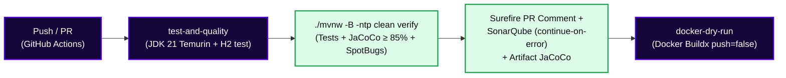

[⬅ Volver al README Principal](../../README.md)

---

## 9. CI/CD CON EL BADGE DEL PIPELINE

El repositorio ejecuta el flujo automatizado **`CI - Integración Continua y Calidad`** definido en `.github/workflows/ci.yml`. Cada *Pull Request* hacia `master`, `main` o `develop`, así como cada *push* sobre ramas `feature/**`, `bugfix/**`, `hotfix/**` o `ci/**` (además de ejecución manual con `workflow_dispatch`), dispara compilación en Java 21, pruebas unitarias e integración, validación estricta de JaCoCo (`≥ 85 %`), análisis estático con SpotBugs (`4.8.6.4`), reporte opcional de SonarQube y construcción de prueba de la imagen Docker.

### Badges de Pipelines y Calidad (GitHub Actions & Calidad)

  
  
  
  
  

### Matriz de Pipelines por Rama Protegida

| Pipeline | Rama / Entorno | Trigger de Ejecución | Quality Gate Requerido | Estado |
| :--- | :--- | :--- | :--- | :---: |
| **`test-and-quality` + `docker-dry-run`** | `develop` / `QA` | `pull_request` hacia `develop` | `clean verify` (Tests + JaCoCo `≥ 85%` + SpotBugs) + Buildx `Dockerfile` |  |
| **`test-and-quality` + `docker-dry-run`** | `master` / `main` / `PROD` | `pull_request` hacia `master` o `main` | `clean verify` (Tests + JaCoCo `≥ 85%` + SpotBugs) + Buildx `Dockerfile` |  |
| **`test-and-quality` + `docker-dry-run`** | `feature/**`, `bugfix/**`, `hotfix/**`, `ci/**` | `push` sobre la rama de trabajo / `workflow_dispatch` | `clean verify` (Tests + JaCoCo `≥ 85%` + SpotBugs) + Buildx `Dockerfile` |  |

### Diagrama del Flujo Automatizado (Pipeline Stages)

### Estructura de Jobs en `.github/workflows/ci.yml`

1. **Job 1 · `test-and-quality` (`Build, Tests & Quality Gate` sobre `ubuntu-latest`):**
   * Ejecuta con perfil `SPRING_PROFILES_ACTIVE=test` y base H2 en memoria (`jdbc:h2:mem:testdb`).
   * Realiza checkout con historial completo (`fetch-depth: 0`), instala JDK 21 Temurin con caché Maven y otorga permisos a `mvnw`.
   * Corre `./mvnw -B -ntp clean verify`, ejecutando las 17 suites de pruebas, `jacoco:check` (`≥ 85%`) y `spotbugs:check` (`Max`/`High`).
   * Publica comentarios automáticos de pruebas con `EnricoMi/publish-unit-test-result-action@v2`, corre `sonar:sonar` con `SONAR_TOKEN` (en modo `continue-on-error: true` para no fallar si no hay token configurado) y sube el reporte HTML de JaCoCo (`jacoco-report-${{ github.sha }}`) con retención de 7 días.
2. **Job 2 · `docker-dry-run` (`Validar compilación de Dockerfile`, `needs: test-and-quality`):**
   * Configura Docker Buildx (`docker/setup-buildx-action@v3`) y valida que el `Dockerfile` construye limpiamente (`push: false`, etiqueta `test-image:test`, caché GHA `mode=max`) sin publicar imagen desde el flujo CI de PR.

  
  
<b>Figura 9.1:</b> Pipeline <code>CI - Integración Continua y Calidad</code> ejecutado exitosamente en GitHub Actions con <code>test-and-quality</code> y <code>docker-dry-run</code> en verde. <i>[PENDIENTE: capturar y guardar <code>docs/images/pipeline-ci-cd.png</code>]</i>

---

[⬅ Volver al README Principal](../../README.md)
